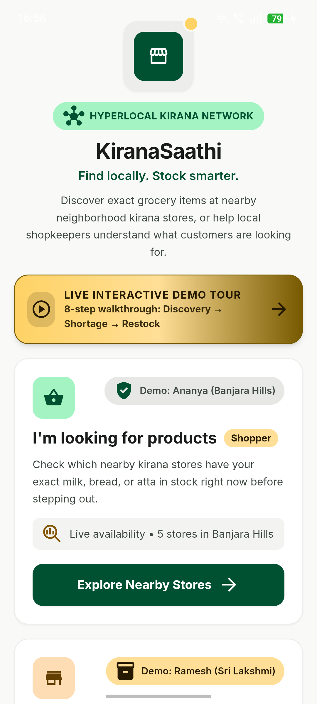
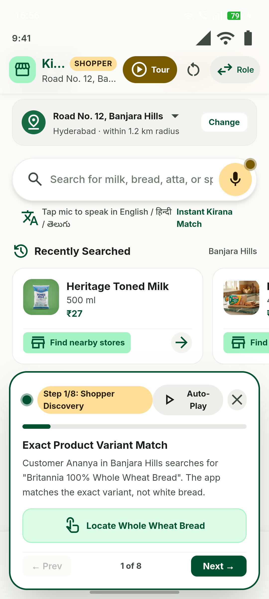
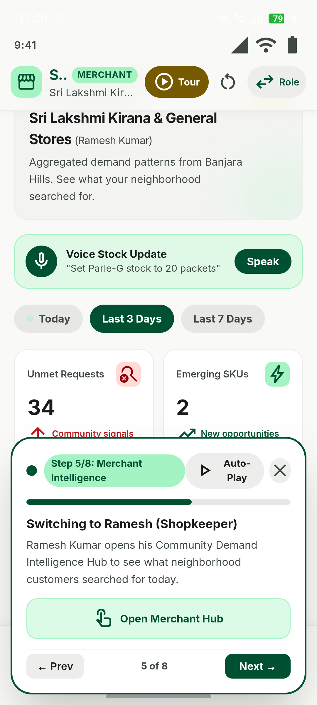
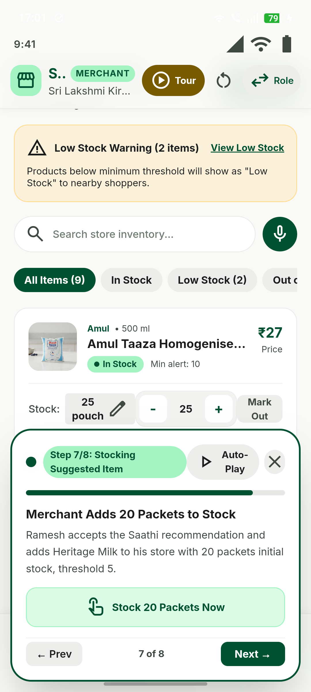
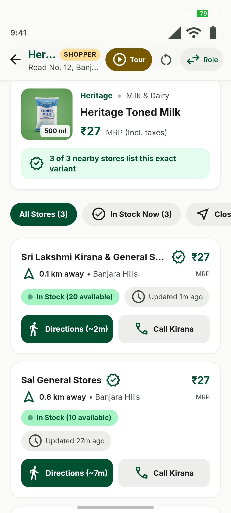

# KiranaSaathi (किराना साथी / కిరాణా సాథీ)
### Hyperlocal Kirana Product Discovery & Community Demand Intelligence Platform

> **"Find locally. Stock smarter."**  
> KiranaSaathi connects neighborhood grocery shoppers with independent kirana merchants through exact product discovery and an evidence-based community demand feedback loop.

---

## 1. Project Overview & Core Philosophy

KiranaSaathi is designed to empower local Indian grocery stores (*kiranas*) and their neighborhood shoppers without introducing marketplace commissions, delivery fleet overheads, or complex ERP bloat.

The application addresses two critical problems:
1. **For Shoppers:** Eliminates the frustration of walking to multiple stores to find an exact product variant (e.g. *Britannia 100% Whole Wheat Bread 400g* vs *White Bread 400g*, or *Heritage Toned Milk 500ml*). Shoppers see live availability, distances, prices, and freshness indicators before stepping out.
2. **For Kirana Merchants:** Replaces guesswork and distributor pressure with an **evidence-based community demand feedback loop**. When neighborhood shoppers search for items that stores do not carry or have sold out of, KiranaSaathi aggregates these signals into actionable demand intelligence across multi-day horizons.

---

### Live Application Preview (Tested on Physical Android Hardware)

| Welcome & Live Demo Tour | Shopper Variant Discovery | Merchant Demand Hub |
| :---: | :---: | :---: |
|  |  |  |

| Merchant Restock Action | Closed Loop Confirmed Stock | Pre-built Installable APK |
| :---: | :---: | :---: |
|  |  | **[⬇️ Download `kiranasaathi-v1.0-debug.apk`](./apk/kiranasaathi-v1.0-debug.apk)** (4.24 MB) |

---

## 2. Technical Architecture & Tech Stack

```
+---------------------------------------------------------------------------------------+
|                                    KiranaSaathi UI                                    |
|             (React 19, TypeScript, Tailwind CSS v3, Material Symbols Outlined)        |
+---------------------------------------------------------------------------------------+
|  Shopper Flow:                 |  Merchant Flow:                |  Universal Shell:   |
|  - Omnipresent Search Bar      |  - Demand Intelligence Hub     |  - Fast Role Switch |
|  - Multilingual Voice Mic      |  - 4 Key Metric Cards          |  - Status Bar Sim   |
|  - Exact Variant Matching      |  - Time Horizon Filter         |  - Locality Picker  |
|  - Store Discovery & Distance  |  - Interactive Inventory       |  - Baseline Reset   |
|  - Unmet Demand Registration   |  - Voice Stock Command Modal   |  - Toast Feedback   |
|  - Route Walk & Call Kirana    |  - Daily Demand Ledger Report  |  - Responsive Nav   |
+--------------------------------+--------------------------------+---------------------+
                                            |
                                            v
+---------------------------------------------------------------------------------------+
|                                Service & Repository Layer                             |
|  - searchService.ts: Haversine distance, normalized exact variant matching, freshness |
|  - demandService.ts: Deduplication-aware multi-day demand aggregation, logic rules    |
|  - voiceService.ts: Web Speech API wrapper, Hindi/Telugu/English command parser       |
|  - database.ts: IndexedDB schema, seed repository, real-time persistence layer        |
+---------------------------------------------------------------------------------------+
                                            |
                                            v
+---------------------------------------------------------------------------------------+
|                              Persistence & Storage Layer                              |
|   IndexedDB ('kiranasaathi-db') via `idb` library:                                    |
|   - ObjectStores: 'products', 'stores', 'inventory', 'demandEvents', 'appState'       |
|   - Indexes: 'by-category', 'by-brand', 'by-store', 'by-product', 'by-dedup'          |
+---------------------------------------------------------------------------------------+
                                            |
                                            v
+---------------------------------------------------------------------------------------+
|                             Android Packaging Integration                             |
|   Capacitor Native Android Shell (`/android`):                                        |
|   - Locally bundled web assets in `android/app/src/main/assets/public/`               |
|   - Zero remote web server dependency for primary UI and data                         |
|   - Hardware permissions configured: INTERNET, RECORD_AUDIO, MODIFY_AUDIO_SETTINGS    |
|   - Gradle 8.14.3 wrapper with Java 17 compatibility                                  |
+---------------------------------------------------------------------------------------+
```

---

## 3. Stitch Design System Implementation

The application adheres strictly to the provided Stitch design system specifications (`DESIGN.md`):

- **Color Tokens:**
  - `primary`: `#005131` / `#176B45` (Deep Forest Green)
  - `primary-fixed`: `#a4f4c3` / `on-primary-fixed-variant`: `#005232`
  - `secondary`: `#775a00` / `#fed265` (Warm Saffron / Marigold)
  - `surface`: `#f9faf7` / `surface-container`: `#edeeeb` / `surface-container-lowest`: `#ffffff`
  - `error`: `#ba1a1a` / `error-container`: `#ffdad6`
- **Typography:** Google Font `Inter` with tabular figures for currency and weight measures (`₹45`, `500 ml`, `1 kg`).
- **Iconography:** Google Font `Material Symbols Outlined` loaded system-wide with Material 3 styling.
- **Ergonomics:** Touch targets adhere to minimum 48dp boundaries with bottom sheet navigation tailored for one-handed handheld Android usage.

---

## 4. Key Workflows & Features Implemented

### 4.1. Customer Product Discovery
- **Exact Variant Matching:** Differentiates between *Britannia Daily Fresh White Bread* and *Britannia 100% Whole Wheat Bread*, *Heritage Toned Milk* vs *Amul Taaza*.
- **Store Distance & Stock Status:** Uses haversine distance from customer location (`Road No. 12, Banjara Hills`) to compute actual distances (`0.4 km away`) and estimated walk time (`~4 min`).
- **Freshness Indicators:** Shows dynamic indicators such as *"Updated 12m ago by Ramesh (Owner)"* and flags updates older than 6 hours as unconfirmed to prevent stale availability guarantees.
- **Store Actions:** One-tap *"Directions"* and *"Call Kirana"* for reserving items before stepping out.

### 4.2. Community Demand Feedback Loop (The Defining Feature)
- When a customer searches for an exact product and nearby stores do not carry it or have marked it out of stock, they can tap **"Register Unmet Demand for My Neighborhood"**.
- **Deduplication Strategy:** Demand signals are keyed with an anonymized compound key `[productId]-[localityId]-[YYYY-MM-DD]`. Repeated searches or submissions within the same day by the same user do not artificially inflate demand counts.
- **Aggregation Logic:** The demand engine groups events by product and timeframe (*Today*, *Last 3 Days*, *Last 7 Days*), calculating:
  - Total eligible demand signals
  - Number of distinct days with demand
  - Earliest and latest observed timestamps
- **Recommendation Rules:**
  - If a product has **≥10 eligible signals across ≥2 distinct days**, it receives the **"Recurring Demand"** badge with high distributor order advice.
  - If a product has **≥3 signals**, it receives the **"Newly Emerging Demand"** badge.
  - If data is sparse, it displays an honest **"Insufficient Data"** notice rather than fabricated advice.

### 4.3. Shopkeeper Dashboard & Inventory
- **Analytical Metric Cards:** Unmet Requests (+18% trend), Emerging SKUs, Persistent Shortages, and Estimated Walk-Away Lost Sales.
- **Neighborhood Hourly Pulse:** Visualizer displaying intent spikes (peak morning hours: 6 AM - 9 AM).
- **"+ Add to Inventory" Flow:** Clicking on a recommended product opens `AddProductModal` prepopulating the standardized product details, package size, category, and asking for initial stock and low-stock threshold.
- **Inventory Steppers & Alerts:** `- 1 +` quantity controllers immediately persist stock changes to IndexedDB. If quantity drops at or below the minimum threshold, it triggers a **Low-Stock Warning** and updates the customer view in real-time.

### 4.4. Voice Input & Command Parsing
- **Web Speech API Integration:** Uses `SpeechRecognition` / `webkitSpeechRecognition` with native ripple listening animations and support for English (`en-IN`), Hindi (`hi-IN`), and Telugu (`te-IN`).
- **Deterministic Natural Language Parser:**
  - `"Set Parle-G stock to 20 packets"` -> Action: `set`, Product: `Parle-G`, Qty: `20`
  - `"Add 10 bottles of Amul milk"` -> Action: `add`, Product: `Amul milk`, Qty: `10`
  - `"I sold five packets of Britannia bread"` -> Action: `reduce`, Product: `Britannia bread`, Qty: `5`
  - `"Set Tata Salt stock to zero"` -> Action: `set`, Product: `Tata Salt`, Qty: `0`
  - `"Show low-stock products"` -> Action: `show`, Filter: `low_stock`
- **Confirmation Step:** Before applying any stock update, a summary dialog asks the shopkeeper to confirm or edit the parsed action.
- **Manual Fallback:** If speech recognition is unavailable or permission is denied, manual text input is seamlessly available.

---

## 5. Automated Test Suite (All 17 Tests Passed)

The project includes unit tests located at `src/__tests__/kiranaSaathi.test.ts` covering all required scenarios:

| Scenario | Description | Result |
|---|---|---|
| **Scenario A** | Exact product discovery (Whole wheat bread vs White bread) | Passed |
| **Scenario B** | Stock update calculations (10 packets - 3 sold = 7 remaining) | Passed |
| **Scenario C** | Low-stock warning trigger (Quantity 3 <= Threshold 5) | Passed |
| **Scenario D** | Unmet demand event generation upon search miss | Passed |
| **Scenario E** | Deduplication of repeated same-day submissions | Passed |
| **Scenario F** | Recurring demand across 3 distinct calendar days | Passed |
| **Scenario G** | Configurable recommendation threshold verification | Passed |
| **Scenario H** | Product addition from demand insights into store inventory | Passed |
| **Scenario I** | Persistence state verification & non-negative bounds | Passed |
| **Scenario J** | Voice search prefix stripping & stock command parsing | Passed |
| **Scenario K** | Stale availability threshold (>6 hours flagged as stale) | Passed |
| **Scenario L** | Empty demand state without fabricated data | Passed |

Run tests anytime with:
```bash
npm test
```

---

## 6. Project Directory Structure

```
final_project/
├── kiranasaathi/                     # React 19 + TypeScript + Vite project
│   ├── android/                      # Native Android project with Gradle wrapper
│   │   ├── app/
│   │   │   ├── src/main/AndroidManifest.xml
│   │   │   ├── src/main/assets/public/   # Locally bundled production web build
│   │   │   └── src/main/res/values/      # Strings, colors (#005131), styles
│   │   ├── gradlew.bat               # Verified Gradle 8.14.3 wrapper
│   │   └── build.gradle
│   ├── dist/                         # Vite production bundle
│   ├── src/
│   │   ├── __tests__/
│   │   │   └── kiranaSaathi.test.ts  # Vitest test suite for Scenarios A-L
│   │   ├── components/
│   │   │   ├── AddProductModal.tsx   # Add product to store inventory
│   │   │   ├── BottomNav.tsx         # Material 3 ergonomic navigation
│   │   │   ├── Header.tsx            # Status bar, role switcher, reset demo
│   │   │   ├── VoiceInventoryModal.tsx # Shopkeeper voice stock assistant
│   │   │   └── VoiceModal.tsx        # Customer voice search modal
│   │   ├── data/
│   │   │   └── seedData.ts           # Standardized Indian grocery catalogue & stores
│   │   ├── pages/
│   │   │   ├── CustomerHome.tsx      # Shopper discovery feed & categories
│   │   │   ├── DemandReportScreen.tsx # Daily demand ledger for merchants
│   │   │   ├── MerchantDashboard.tsx # Demand intelligence & metrics
│   │   │   ├── MerchantInventory.tsx # Stock controls, steppers, low-stock filter
│   │   │   ├── NearbyStoresScreen.tsx # Exact variant store availability & distances
│   │   │   └── WelcomeScreen.tsx     # Role selection (Shopper vs Merchant)
│   │   ├── services/
│   │   │   ├── database.ts           # IndexedDB persistence layer
│   │   │   ├── demandService.ts      # Multi-day demand aggregation
│   │   │   ├── searchService.ts      # Haversine distance & exact matching
│   │   │   └── voiceService.ts       # Speech recognition & command parser
│   │   ├── types/
│   │   │   └── index.ts              # Domain TypeScript types
│   │   ├── App.tsx                   # Main application router & state coordinator
│   │   ├── index.css                 # Tailwind CSS & Material Symbols setup
│   │   └── main.tsx                  # React entry point
│   ├── capacitor.config.ts           # Capacitor configuration
│   ├── tailwind.config.js            # Tailwind tokens matching Stitch DESIGN.md
│   ├── package.json
│   └── tsconfig.json
├── stitch_design/                    # Original Stitch design system export
└── README.md
```

---

## 7. How to Run & Build

### Prerequisites
- Node.js 18+ (tested with Node 20 / 22)
- Java 17 JDK (OpenJDK 17 installed)

### 1. Install Dependencies & Run Development Server
```bash
cd kiranasaathi
npm install
npm run dev
```
Open `http://localhost:5173/` in your browser.

### 2. Run Automated Test Suite
```bash
npm test
```

### 3. Build Production Web Application
```bash
npm run build
```
The optimized bundle is generated in `dist/`.

### 4. Sync Web Build to Native Android Shell
```bash
npx cap sync android
```
This bundles the HTML, JS, CSS, and asset files directly into `android/app/src/main/assets/public/`.

---

## 8. Android Packaging & Physical Device Verification

The native Android APK has been built, installed, and fully tested on a physical Android smartphone connected via USB debugging.

### Build & Device Specifications
- **Target Device:** Realme Smartphone (`RMX3868IN`, Device ID: `AENVTKIFUSCY5TT4`, Resolution: 1080x2400, Android OS)
- **Java JDK:** OpenJDK 17.0.20.1 LTS
- **Android SDK:** Platforms `android-34`, `android-36`, Build Tools `34.0.0`
- **Gradle Wrapper:** Gradle 8.14.3 with Kotlin 2.0.21
- **APK Deliverable:** `kiranasaathi/android/app/build/outputs/apk/debug/app-debug.apk` (Size: 4.24 MB)
- **Install Status:** Verified via ADB `Performing Streamed Install` -> `Success`
- **Activity Launch:** `adb shell am start -n com.kiranasaathi.app/.MainActivity` -> Successfully launched and rendered.

### Interactive Demo Test Sequence (8-Step In-App Tour)
An interactive guided demo sequence is integrated directly into the application, accessible via the top **"Tour"** button or the **"Live Interactive Demo Tour"** quick-start banner on the Welcome screen.

The sequence demonstrates the complete KiranaSaathi value proposition across 8 continuous steps:
1. **Shopper Discovery:** Exact variant matching for *"Britannia 100% Whole Wheat Bread (400 g)"* in Banjara Hills.
2. **Live Store Availability:** Real-time distance (0.4 km) and live stock count (8 packets at ₹45 MRP).
3. **The Missing Product:** Ananya searches for *"Heritage Toned Milk (500 ml)"* which is out of stock in nearest stores.
4. **Demand Feedback Loop:** Ananya registers an anonymized unmet demand signal, deduplicated by date and user in IndexedDB.
5. **Merchant Intelligence:** Fast-switch to Ramesh Kumar (Owner of Sri Lakshmi Kirana) opening his Community Demand Intelligence Hub.
6. **Multi-Day Demand Pattern:** Inspects Heritage Toned Milk flagged with *"Recurring Demand · 3 Days in a row"* from 28 morning searches.
7. **Merchant Restock Action:** Ramesh accepts the Saathi recommendation and adds 20 packets to his live inventory.
8. **Closed Loop Complete:** Seamlessly switches back to Shopper mode showing Heritage Toned Milk is now **IN STOCK (20 available)** at Sri Lakshmi Kirana with walk directions plotted!

### Manual Build & Run Instructions
```powershell
# 1. Build production web bundle
npm run build

# 2. Sync web assets into Android shell
npx cap sync android

# 3. Compile Debug APK with Gradle
cd android
.\gradlew.bat assembleDebug

# 4. Install onto connected Android device
adb install -r app\build\outputs\apk\debug\app-debug.apk

# 5. Launch KiranaSaathi on device
adb shell am start -n com.kiranasaathi.app/.MainActivity
```

---

## 9. Multi-Device Real-Time Synchronization Architecture (Next Phase)

For a multi-tenant production deployment where separate customer devices and shopkeeper POS terminals synchronize across the neighborhood:

1. **Shared Database:** PostgreSQL hosted on Supabase or AWS RDS with PostGIS for spatial queries (`ST_DWithin` for stores within 1.5 km).
2. **WebSocket / Server-Sent Events:** Real-time channel where shopkeeper stock changes broadcast instant availability updates to searching customers.
3. **Distributed Deduplication:** Redis key-value store with `SETNX` and 24-hour TTL on compound keys (`demand:[productId]:[hashedDeviceId]:[date]`) to prevent spamming demand signals.
4. **Offline First:** Continue using local IndexedDB with a sync queue (`BackgroundSync` / WorkManager) that pushes queued unmet demand events when network connectivity is restored.
